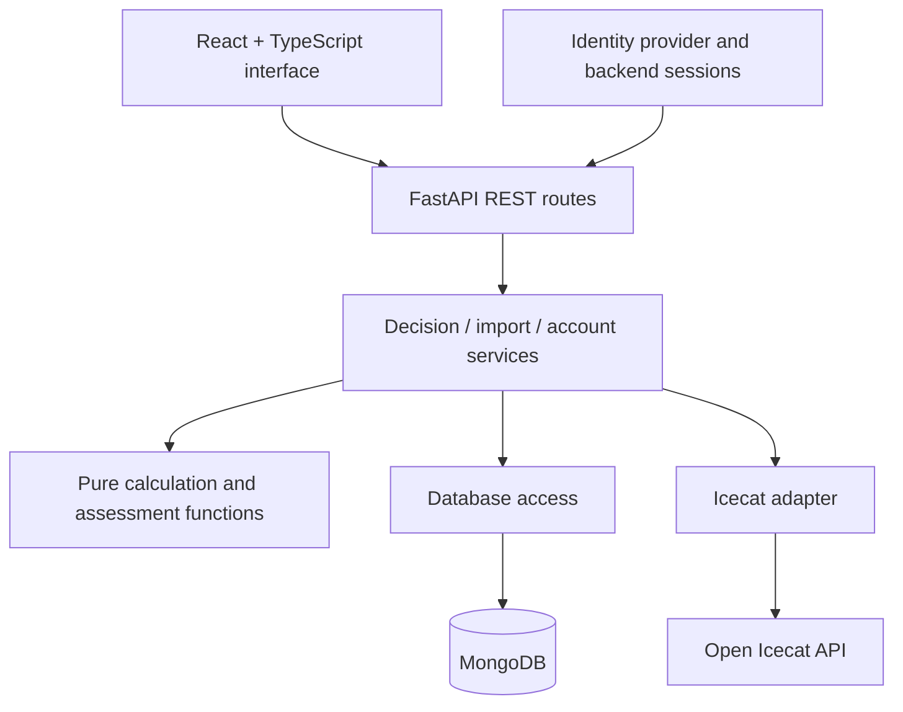
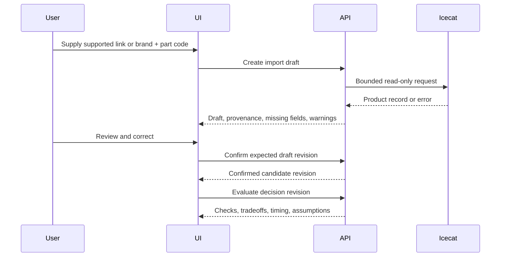

# Architecture

Status: modular architecture direction accepted; concrete implementation choices remain a draft.

## Structure

Use one frontend and one modular backend, not separately deployed microservices. Python domain functions accept explicit inputs and return results/explanations without HTTP or database dependencies. Routes validate requests and user access; services coordinate the use case; database access handles persistence. FastAPI route modules support grouping by responsibility.

TypeScript owns interaction state and rendering; Python produces authoritative evaluations. Avoid maintaining two independent financial models in the browser and backend. Preview interactions can request backend evaluations after valid changes; debounce/caching details will follow measured needs.

## Boundaries

| Boundary | Responsibility |
| --- | --- |
| Needs and evidence | User statements, documented tool prerequisites, unknowns, sources. |
| Assessment | Mandatory checks and their reasons, preference comparisons with comparable evidence; no overall score. |
| Calculations | Contributions, target dates, remaining balances, separate scenario arithmetic. |
| Guidance | Conditional wording and the contribution-suggestion rule, versioned separately from arithmetic. |
| Imports | Identify supported links/codes, request source, map fields, return a draft with issues. No implicit confirmation. |
| Persistence | Ownership, revisions, snapshots, deletion workflow. No domain rules hidden in database queries. |
| Identity | Email/password through established provider; application sessions and authorization stay backend responsibilities. |

## Import sequence

Keep specification records distinct from seller offers. A product must not inherit a price from another configuration. Future retailer adapters can supply offer data without rewriting the comparison/savings steps.

## Operational design

- Begin with bounded API calls and explicit timeouts. Introduce a worker/queue only if actual latency/reliability needs justify it. Scheduled deletion and retention jobs still need reliable execution; their mechanism is undecided.
- Supported Icecat links resolve to validated identifiers. Backend destination is fixed/allowlisted; do not turn supplied URLs into unrestricted server-side fetches.
- Treat product descriptions as untrusted content. Do not execute imported HTML or display it unsanitized.
- External credentials stay server-side outside Git and logs. No API tokens are stored in this design package.
- A retry must not duplicate a confirmed candidate. Authentication, session revocation, cross-site request protection, and ownership checks need integration tests.
- Authentication-provider and application sessions are distinct. Password reset/logout/deletion must enforce the intended application-session effects explicitly.
- Backups, recovery, email delivery, hosting services, budgets, and region selection remain concrete deployment choices. AWS is not provisioned or selected at a service level.

## Demonstrating changeability

| Change | Expected change surface | Existing behavior to protect |
| --- | --- | --- |
| Savings formula adjustment | Calculation implementation/version and tests; explanation if changed | Historical snapshots and UI contract |
| New supported source | Adapter, mapping, source permissions, controlled samples | Review/confirmation and evaluations |
| New laptop preference | Preference schema, assessment, UI, tests | Mandatory eligibility and existing decisions |
| Automatic catalog | Discovery and maintenance feeding product drafts | Review, eligibility, costs, saved reasoning |
| Future vehicles | Separate researched category model; migrations if needed | Shared planning and account behavior |

No generic plugin platform, rules DSL, event-sourced system, or speculative vehicle/housing schema is required. Some extensions will need migrations; clear boundaries reduce impact rather than eliminate all changes.

## Alternatives and tradeoffs

- **Microservices:** rejected for v1; more deployment and coordination overhead without established need.
- **Single overall score:** deferred; eligibility and timing must remain separate and missing evidence makes a score misleading.
- **Page parsing plus API immediately:** deferred; API samples succeeded, and manual completion provides a simpler fallback.
- **MongoDB vs SQL:** MongoDB is retained from the working stack; nested needs/evidence fit document records. This does not remove the need for schema validation, ownership constraints, consistency controls, and migrations. A normalized SQL design would also be viable; no benchmark establishes MongoDB as superior.
- **Auth0:** recommended identity provider direction, with email/password only. Exact plan, email delivery, and session configuration must be verified before selection/configuration is final.
