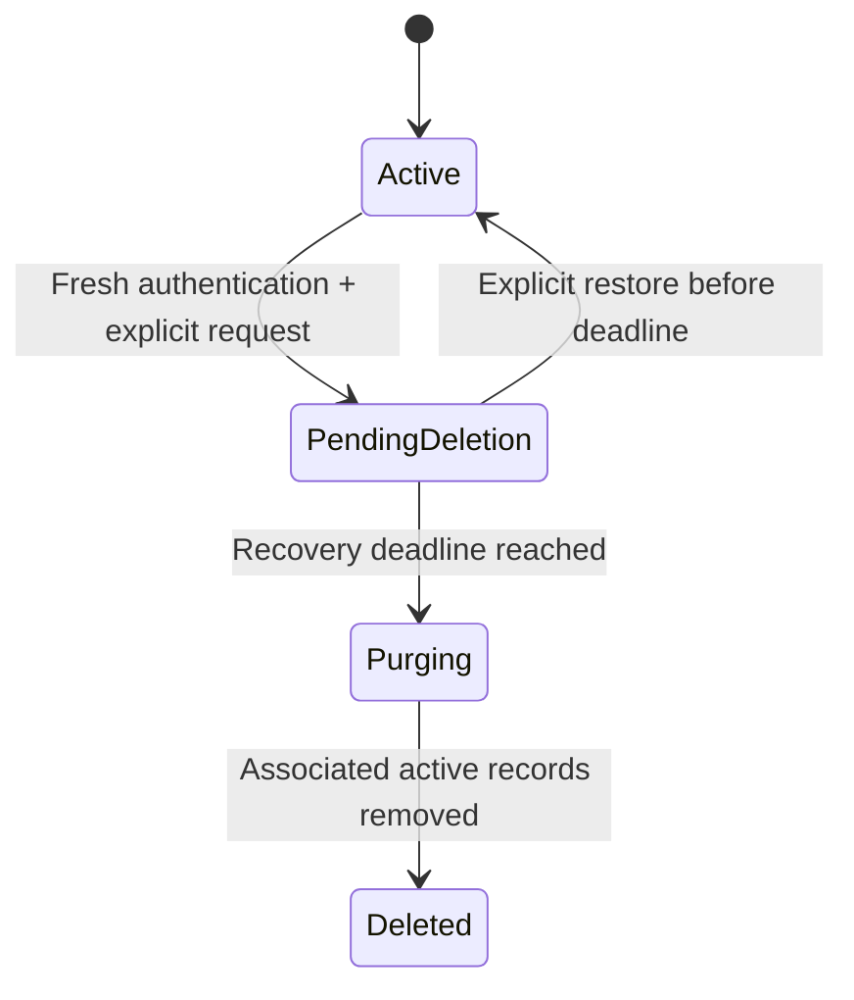

# Calculation rules and account lifecycle

Product behavior below reflects accepted direction, including the user's subsequent approval of all six remaining product defaults. Operating guarantees marked as proposals still need implementation/hosting verification. These rules are not professionally validated financial advice.

## Savings model

Inputs: purchase savings `S`, selected cost `C`, user-chosen monthly contribution `P`, first contribution date, optional target date. Use USD cents. Savings are funds the user designates for this purchase, not their entire bank balance.

- Remaining goal: `G = max(0, C - S)`.
- Count actual scheduled contribution dates on/before the target as `N`; do not approximate months by dividing days by 30.
- With `N > 0`, deadline-required monthly contribution in cents is `ceil(G / N)`.
- If `G = 0`, the purchase is already funded; no further contribution is needed.
- If `G > 0` and `N = 0`, show that no scheduled contribution occurs before the target, not a division error or a zero requirement.
- If `G > 0` and `P = 0`, no finite purchase date is reached under the plan.
- Otherwise, required contribution count is `ceil(G / P)`. Reachable date is the corresponding scheduled date. Cap the final required deposit at the remaining amount when displaying a deposit schedule.
- Assume equal contributions and unchanged costs; no interest, investment returns, financing, or automatic future price prediction.
- Missing complete cost prevents a confirmed timeline. An explicitly selected provisional total permits an assumed timeline labeled provisional. Any budget comparison dependent on it is also provisional.

**Accepted date convention:** first contribution date anchors a monthly schedule in the user's timezone. For an anchor day absent in a month, use that month's last day, then return to the original anchor in later months (Jan 31 → Feb end → Mar 31). A contribution on the target date counts. This repeats the original day of the month where possible; it does not drift to the next day or permanently adopt February's last day.

## Optional budget and suggested contribution

Monthly signed balance: take-home income minus entered expenses minus commitments to other goals minus the extra amount the user chooses to leave unallocated. Keep these categories distinct to avoid double subtraction. A negative result remains visible as a shortfall.

Accepted suggestion direction:

1. With complete budget inputs and a target, suggest the smaller of the target-required contribution and the nonnegative modeled capacity.
2. Explain any deadline shortfall. Do not call the result universally safe, affordable, or professionally advised.
3. Without budget inputs, show the target-required amount only; it is not an affordability assessment.
4. Without a target, show modeled capacity and ask the user to choose; do not automatically allocate all of it.
5. If already funded, suggest no additional contribution for this goal.
6. User choice controls the actual plan. Warn if the choice exceeds modeled capacity; do not silently change it.

No suggestion is calculated from incomplete budget totals by treating missing categories as zero. Explicitly entered zero is allowed. Irregular income is a user assumption in this monthly model; timing of bills/income is not modeled as a cash-flow guarantee.

## Spending-change scenario

Save one alternative with a selected base expense category, reduction, and amount allocated to the purchase. Enforce `0 <= purchase allocation <= reduction <= category expense`. Base contribution plus allocation produces the scenario contribution. Other released money is not silently assigned to the purchase. Compare both plans and keep the original input values intact.

If base expenses change and invalidate the reduction, flag the scenario for revision. A scenario assumes the user actually makes the change; it does not establish that transport, housing, food, or any other category is discretionary.

## Eligibility and preference rules

- Any failed mandatory check → does not meet requirements.
- No failures and at least one unknown → needs verification.
- All mandatory checks met → meets requirements. Empty-requirement handling must avoid claiming technical suitability with no checks; explain that no technical requirements were set.
- Cost ceiling is optional, separate from cost preference. Unconfirmed cost leaves a cost-dependent check unknown.
- Suitability, preference tradeoffs, and purchase timing remain separate. An essential deadline can additionally fail plan feasibility without rewriting technical compatibility.
- Explain ties and conflicting preferences. Do not invent a total score or benchmark. Avoid comparing battery claims made under incompatible test conditions as equivalent measurements.
- Meeting a tool's documented prerequisites is not a guarantee of comfortable combined-workload performance.

## Account lifecycle

Email/password is accepted; no social login in v1. Auth0 is recommended but not configured. Budgets are optional and remain separate from identity data.

| Behavior | Status |
| --- | --- |
| Email verification before persistent private workspace; fictional demo accessible without account | Accepted |
| Provider-managed password reset, neutral request response, explicit application-session invalidation | Accepted behavior; provider integration still to verify |
| One-hour inactivity and 24-hour absolute session lifetime | Accepted initial settings |
| Sign-out removes displayed private state but not saved records | Accepted |
| JSON export of user-owned inputs, decisions, plans, and reasoning | Accepted format; inclusion of licensed product content unresolved |
| 30-day deletion recovery period, notification, explicit restoration | Accepted |
| Backup copies removed no later than 30 days after official active deletion | Accepted policy target; hosting/process verification pending |
| No automatic account deletion for inactivity | Accepted |

## Individual item deletion

Accepted separately from account deletion: removing a candidate takes it out of the working comparison while prior snapshots retain their historical meaning, subject to source-content retention. Deleting an entire decision requires explicit confirmation that its candidates, plans, and snapshots will be deleted. No 30-day user recovery window applies to individual decision deletion in v1. Backup expiry is a separate policy, not a user-facing trash feature.

## Deletion state machine

On request: revoke normal sessions, disable ordinary workspace access, record an exact deadline, and send a notification saying **scheduled for deletion**, not already permanently deleted. Display the deadline with timezone. Authentication alone does not restore the account. No restoration is allowed at/after the deadline even if the purge job is delayed.

Retain identity capability needed to authenticate restoration until final purge. On restoration, cancel the purge and issue a new normal session. On final purge, remove application records and the associated provider identity according to a reliable, retryable process. Provider failure must not restore workspace access.

The email states that restoration is available for 30 days and that older system backups may remain for up to a further 30 days after official deletion, with no user recovery option. Email delivery failure does not imply that the deletion request failed; show both statuses and support retry.

**Proposed operational targets:** daily backups with a rolling 30-day retention; no longer-lived copies without an explicit policy change. Exact purge scheduling, failure handling, identity-provider deletion, email deliverability, logs, and backup-removal guarantees require implementation/hosting decisions before public promises. The accepted policy is a maximum removal period, not an instruction to keep every backup until day 60.

Keep a minimal protected deletion record (opaque identity and deletion state/deadline, no budget or product content) long enough to reapply deletions after any eligible backup restoration. It must outlast potentially stale backups; its own precise retention needs final specification. Restoration is performed in isolation, with deletions/revocations reapplied before serving users. Prevent new backups from repeatedly extending the life of deleted records by restoring them into active use.

## Versioning

Store schema, calculation, guidance, and assessment versions separately. Saved snapshots retain original outputs; new evaluations identify the version used. A compatibility/migration policy is needed when schema changes. License-dependent product retention may limit what historical source evidence can be copied into snapshots; do not claim this is resolved.
