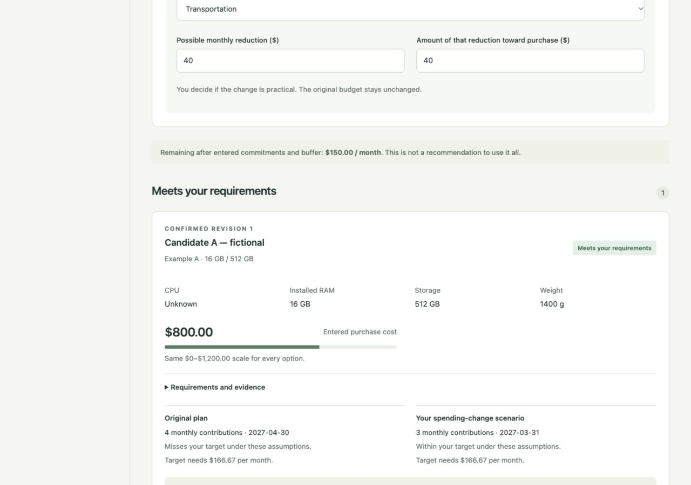

# Implementation evidence — milestone 1

Date: November 12, 2026. Scope: one fictional/manual laptop decision locally. This log records checks actually run, not production-readiness claims.

## Authorization and contributions

The user authorized starting the first coding milestone after committing the Icecat clarification. That clarification was committed locally as `8d10ce4`; the two pre-existing origin README commits were merged without removing their edits. No changes were pushed or published.

The user selected the product rules and architecture, supplied the provider's permission clarification, installed the Python requirements when this session could not download them, and started both development servers when the session could not bind local ports. AI implemented the domain/API/frontend, wrote boundary tests, and performed browser checks. This is collaborative, AI-assisted implementation.

## Implemented behavior and tradeoffs

- Manual current-device and replacement inputs with optional unknown specs; only confirmed revisions enter evaluation. Edits leave the previous confirmed revision intact until reconfirmation.
- Explicit RAM, storage, price-ceiling, and required-tool compatibility requirements. Known failures dominate unknowns; an empty requirement set does not claim suitability. No automatic software requirement inference or CPU-name scoring.
- Eligible, needs-verification, failed, and unset groups. Preference evidence describes comparable weight, cost, or matching-context battery measurements among eligible replacements. Importance is displayed without an invented overall score. Performance and repairability remain evidence notes.
- Exact integer cents, complete component cost versus a separate provisional total, original-day monthly anchoring, inclusive deadlines, contribution counts, and last-installment arithmetic.
- Optional signed budget capacity and a separately calculated spending-change alternative. A suggestion never overwrites the user's contribution. No assumed interest, financing, or future discount.
- Versioned stateless API with validated contracts, useful validation messages, timeout/retry handling, and stale-input response suppression. No persistent save endpoints or pretend authentication.
- In-tab decision review, invalidated when its evaluated inputs, model versions, or reasoning change. Reload loses the workspace. This deliberately precedes MongoDB and immutable snapshots.

The decisions trace to the accepted requirements and calculation sections in [requirements](requirements.md), [calculations](calculations-and-lifecycle.md), and the [milestone scope](implementation-milestone-1.md). This first slice does not claim completion of every v1 acceptance criterion.

## Automated checks

- Python unittest: **35 passed**, including real FastAPI/ASGI contract requests, strict monetary types, confirmation checks, unknown values, cost modes, leap/month-end dates, target boundaries, zero contributions, already funded purchases, large date ranges, failure dominance, scenario bounds, unchanged base budgets, and incomplete/negative capacity.
- Frontend Node tests: **8 passed**, covering exact cents, invalid/unknown values, partial candidates, identity/source validation, confirmed-only payloads, removal of only the price ceiling, and scenario separation.
- `npm run build`: **passed**, including strict TypeScript checking and Vite production bundling.
- Runtime: Python 3.14.1; Node 24.15.0; React 19.2.6; Vite 8.3.5; TypeScript 5.9.3; FastAPI 0.162.5. Locks record full dependency versions.
- TestClient emits a Starlette deprecation warning about httpx. No failing check was hidden or suppressed.

## Browser checks

Against the user-started local frontend and backend:

- Reviewed and confirmed baseline and both fictional candidates. Candidate A with confirmed tool support met the selected requirements; Candidate B failed the $900 ceiling despite unknown tool support.
- Observed $800/$1,100 contribution counts of **4/6** at $150 and **3/5** at $190. Candidate A's scenario reached March 31, while the original reached April 30. Base capacity remained $150 and the chosen contribution remained $150.
- A $200 reduction from a $180 transportation category produced a visible validation error and **zero result cards**; the earlier successful comparison was not shown as current.
- Editing A's price to $850 without reconfirming retained its confirmed $800 comparison. Restoring the draft removed the pending change.
- Confirming B's tool support and removing the ceiling made both replacements eligible and exposed A's lower-weight evidence. Reinstating the ceiling returned B to the failed group.
- Captured an in-tab review, then changed its reasoning; the UI marked the review outdated.
- Inspected desktop layout at 1280 × 900 and mobile at 375 × 812. Mobile document width and scroll width were both 375 pixels. Reset the temporary viewport afterward. Navigation moved focus to the step heading. Native labeled form controls were used; a complete keyboard-only or assistive-technology audit was not performed.
- Browser captured no warning/error console entries during this journey. The working tab was left open for user review; user-owned terminal servers were left running.

## Remaining limitations

No MongoDB, accounts/email/password, deletion/recovery emails, live Icecat/link imports, JSON export, durable historical snapshots, Docker packaging, or deployed infrastructure exists yet. Source links are references only. These remain in intended v1 sequencing where specified; automated discovery/catalogs and broader role profiles remain future-version backlog items. Compatibility is user-confirmed evidence rather than a tool checker. No real product coverage/accuracy, professional financial validation, security audit, or production readiness is claimed.

Next: user feedback on this working flow, followed by a separately scoped persistence/ownership milestone and then import and account integrations. The calculation layer and HTTP contracts can be extended without embedding those integrations in the UI arithmetic.
