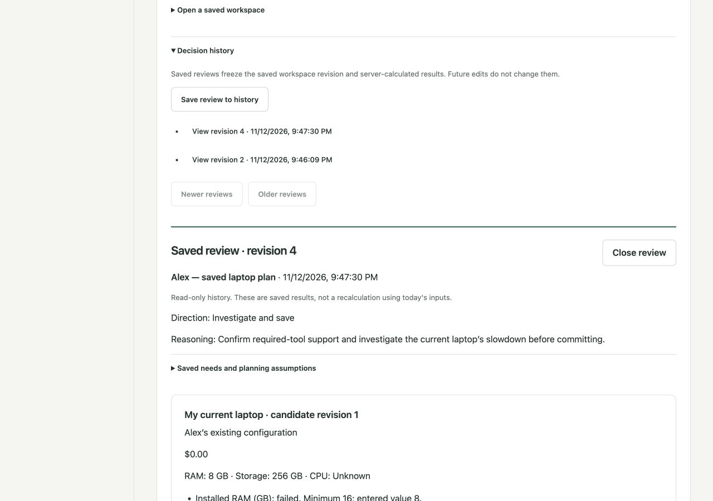

# Milestone 2 — local saved workspaces and review history

Authorized November 12, 2026, when the user agreed to continue with saved workspaces and decision history. This local slice is implemented and verified; it does not complete version 1.

## Delivered

- MongoDB-backed workspace creation, explicit saves, listing/opening, and a separate-copy action.
- Restoration from the saved workspace's URL after reload. Unsaved changes remain a distinct draft and are not silently autosaved.
- Expected-revision updates: stale tabs receive a conflict instead of overwriting a newer saved workspace. Current local edits are retained on failed saves.
- Candidate confirmation revisions remain distinct from unconfirmed draft edits. Candidate revisions cannot move backward or replace confirmed values without advancing their revision.
- Explicit historical review capture from an already-saved workspace revision. The server builds the evaluation from the saved inputs; the client cannot supply historical results.
- Read-only historical inputs, reasoning, candidate confirmation revisions, evaluation, and model versions. Later workspace edits do not recompute or overwrite older reviews.
- Server-selected ownership boundary, implemented temporarily as one fixed development owner. Client-supplied owner fields are rejected. This is not multi-user authentication or private-account isolation.
- Explicit calendar timezone, schema versions, UTC event timestamps, bounded workspace inputs, bounded result pages, idempotent creation/review requests, storage timeouts, and visible failures.

## Consistency and storage choices

A working decision embeds at most 20 candidate records, including exactly one baseline, with bounded fields and strict schemas. Updating this bounded record uses MongoDB's atomic expected-revision filter. This keeps its inputs and candidate revisions together without a multi-document transaction. Growing history lives in a separate snapshots collection, rather than an unbounded array inside the working record.

Snapshot creation reads one saved workspace revision, checks the expected revision, evaluates that captured copy, then inserts a self-contained historical record. A concurrent workspace update may finish afterward; the snapshot still truthfully describes its recorded revision. It does not promise to be the newest workspace state at insertion time. The application has no snapshot mutation route. Retry IDs prevent duplicate creation; no deletion endpoint is added in this slice.

All currency remains USD under schema 1. Planned normalized import/evidence records, a broader per-candidate revision repository, export APIs, migrations, and account lifecycle operations remain subsequent work.

MongoDB's [atomic-write guidance](https://www.mongodb.com/docs/manual/core/write-operations-atomicity/) supports filtering updates by the expected current value. PyMongo is isolated in the repository module; arithmetic stays in the pure domain layer.

## Local operation and ownership limit

Docker Compose supplies MongoDB 8.0 on loopback port 27017, with a named data volume. `PDW_LOCAL_STORAGE=1` explicitly enables storage routes. The backend defaults to storage disabled; evaluation still works without it. The storage dependency refuses non-loopback clients and unexpected browser origins. The backend remains bound to 127.0.0.1. Storage failures never substitute an in-memory database and claim a successful durable save.

This local database has no account protection. Keep fictional data and do not expose the database or backend publicly. Email/password identity and server-side private ownership must replace the development owner before a public or multi-user deployment. No provider account, cloud database, deployment, paid service, or push was created.

## Verification and contributions

- AI-authored/run: 46 backend/domain/API tests passed using pure rules, ASGI requests, and an injected in-memory test repository. The test double is never used by the application. Twelve real-database tests are skipped unless explicitly enabled.
- User-run: **12 real MongoDB integration tests passed**, including atomic concurrent updates (exactly one success and one conflict), repository recreation, ownership filtering, snapshot immutability, idempotency, and pending-draft separation. The user supplied the successful terminal output. Each test used a fresh `pdw_test_<random UUID>` database and removed only that database.
- AI-run: **8 frontend tests passed** and the TypeScript/Vite production build passed. Total across these checks: 66 passing tests, with real-database execution performed in the user's terminal because this session blocks direct socket access.
- Browser: saved a fictional workspace, reloaded it, confirmed baseline/A, saved revision 2 and captured its $800/$150/four-contribution review. Saved $190 as a later working revision, reloaded it, and observed the earlier review still showing four contributions. Captured revision 4 showing three contributions. No earlier snapshot was rewritten.
- Browser: opened the same workspace in a second tab, saved a newer revision in the first, then attempted a stale save in the second. The visible conflict left its draft intact. Also verified the separate-copy action created another workspace ID.
- Browser: inspected the history layout at 375 × 812 and 1280 × 900. Mobile document and scroll widths were both 375 pixels. Reset the viewport and closed auxiliary test tabs; left the main saved workspace and user-owned servers running. Full accessibility, failure-injection, and browser automation coverage remain future work.
- User installed PyMongo, started Docker/MongoDB, restarted the backend, and ran the real-database tests when session restrictions blocked those operations.
- The existing Starlette TestClient/httpx deprecation warning remains; checks pass without suppressing it.

## Still required for version 1

Email/password accounts and verified ownership; account deletion/recovery and emails; live Icecat/link imports and provenance mapping; JSON export; deployment, backups, operational retention, and complete integration/security/accessibility verification. The 30-day account recovery and subsequent backup retention policy is not implemented by this local workspace milestone.

The user subsequently requested a local checkpoint commit containing milestones 1 and 2, including code, tests, setup, and evidence. No push or publication was requested.
