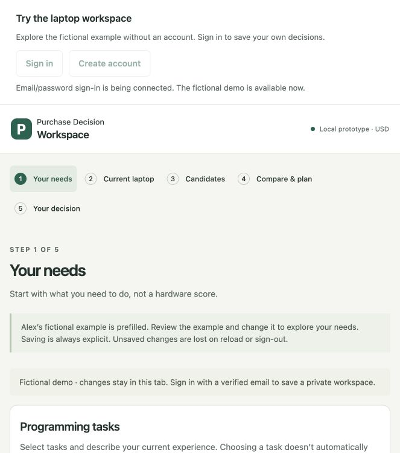
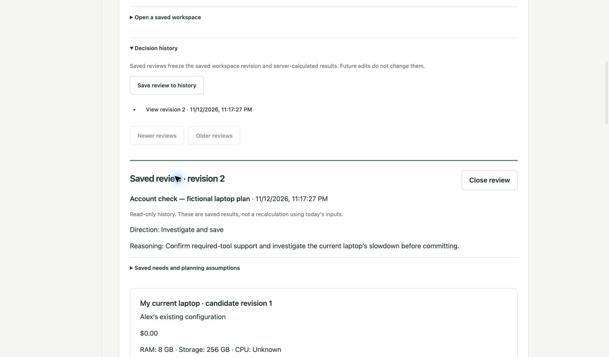

# Milestone 3 — email/password accounts and private ownership

Status: local account milestone implemented and core live journey verified on November 12, 2026. The user authorized this work after the milestone 1–2 checkpoint commit (`1572b1d`). Version 1 remains in progress; no deployment or production security claim is made.

## Implementation

- Auth0 hosted Universal Login, restricted to the configured database connection; no app password collection or social sign-in. Authlib handles the authorization-code/OIDC protocol with S256 PKCE, state, nonce, signed claims, issuer, audience, and expiry validation.
- Short-lived login flow data lives in MongoDB behind a random HttpOnly cookie. The entire flow is atomically consumed before processing a callback, so a copied URL without the browser cookie or a replay cannot obtain another session.
- App sessions are distinct from Auth0 sessions. Browser cookies contain a random opaque value, with only its SHA-256 digest stored as the session lookup key. Provider ID/access tokens are not stored in workspace documents or browser storage.
- Stable ownership derives from validated issuer + subject, never email, a form owner field, or a selected workspace ID. Two accounts sharing the same email would still have distinct ownership. The previous development owner's documents are not automatically assigned or migrated.
- Current Auth0 Management API profile checks enforce verified email, blocked-account state, and password-reset invalidation. The adapter uses the documented basic user request and immediately projects five needed fields; unrelated profile metadata is neither stored nor returned to the browser. The server-only Machine to Machine application requires read:users only. A failed provider check denies private access without falling back to the development owner.
- One-hour inactivity and 24-hour absolute lifetimes are checked on the server, even before TTL cleanup. Background session polls do not extend idle time; throttled user activity does. Logout revokes the application session without deleting saved records. Restricted account states cannot use ordinary workspace APIs.
- State-changing private requests require a per-session CSRF token plus origin validation. Private/account responses use no-store; authentication query parameters are removed from Uvicorn access-log entries.
- The frontend waits for a session check before rendering private records, closes them on signout/expiry/account restriction, and remounts state for another identity or new login. The fictional demo remains available without login. Only explicit workspace save actions persist decision edits; authentication/session records are separate necessary account state.
- Password-reset requests use the same neutral response for unknown accounts and provider failures, with bounded requests. The account holder alone completes password entry and recovery links.

## Local configuration and remaining live checks

See [Auth0 setup](auth0-setup.md). Backend settings are in an ignored `backend/.env`. No credential is committed or requested in chat. The local callback uses the frontend origin with its /api proxy. The account holder must create/accept provider accounts, configure the applications, enter credentials locally, and complete signup/verification/reset steps.

The implementation defaults to account mode, which fails closed while unconfigured. Explicit `PDW_AUTH_MODE=local` retains the older, loopback-only demonstration owner for existing fictional records; it is never an automatic fallback. Both modes are local-only; public origins are intentionally rejected in this slice. HTTP development cookies are not a production configuration.

The signed-protocol, MongoDB, and core live sign-in/save/reload/sign-out/re-login checks passed. The user completed real app signup and password reset; the app subsequently showed verified email status. User-private ownership and password-reset session revocation are covered by real MongoDB API tests using controlled provider responses. A second live Auth0 account and reset of an already-active live app session were not exercised; full v1 integration verification remains to expand. Development reset emails were delivered, but production email delivery and quota planning are not established. The app's account deletion/recovery/purge, export, live product import, and hosting/backup work remain unfinished v1 requirements.

## Verification so far

- 28 new offline account tests passed: idle/absolute boundaries, cookie hashing, atomic-flow call contracts, state restrictions, current profile checks, password-reset revocation, owner isolation through the API, CSRF/origin protection, logout retaining records, neutral recovery response, provider outage, and credential-safe configuration/log messages.
- 13 frontend tests passed (8 existing, 5 session-policy tests), including private-render eligibility, conservative expiry, and workspace-state reset across identities/logins.
- TypeScript/Vite production build passed.
- Full backend discovery ran 109 tests: 86 passed here, including all 9 real Authlib signed-protocol fixtures, while 23 Mongo checks were skipped in this restricted session. The user ran the original 12 workspace Mongo checks and all 11 current account Mongo checks successfully in their terminal. With 13 frontend tests, **122 automated checks passed** across these runs. Three provider-wire tests cover the rejected field query, five-field projection, token reuse, and credential-safe errors. No skipped check was counted as passed without separate execution.
- Authlib 1.9.5, python-dotenv 1.2.4, and PyMongo 4.20.0 are recorded in the refreshed Python lock. Authlib and Starlette emit httpx migration deprecation warnings; these were not suppressed. Expected invalid/replayed callback tests emit sanitized sign-in-failure lines and pass.
- Browser observed the unconfigured, account-free demo: no saved lists or private historical information was displayed, and sign-in actions were unavailable until setup. A fictional candidate could still be reviewed and compared (four monthly contributions for the sample $800 plan), with zero save-workspace controls while anonymous. After configuration and a backend restart, the browser reached the real Auth0 hosted email/password page with no social-login option. The account holder completed credentials, password reset, and sign-in themselves; no password or reset link was requested in chat.

## Live verification and corrections

- Read-only inspection confirmed the Regular Web Application, the separate Machine to Machine application, and exactly the intended `read:users` client permission. Application IDs in local configuration matched those applications. No Auth0 grant, connection, billing, or security setting was changed by the agent.
- Auth0 logs distinguished successful signup from later duplicate-signup and wrong-password attempts. The account holder completed password reset; the agent did not enter credentials, retrieve a reset link, or submit a password change.
- A callback diagnostic isolated HTTP 400 to the account-profile request. Removing the optional fields query resolved the real failure; the basic user GET documented by Auth0 supports the required response. Raw profiles are immediately reduced to user_id/email/email_verified/blocked/last_password_reset. The provider-wire regression rejects the old query and verifies this boundary. See [Auth0 Get a User](https://auth0.com/docs/api/management/v2/users/get-users-by-id).
- Review also found a timestamp precision edge case: whole-second OIDC authentication time compared against a fractional-second password timestamp could reject fresh signup. Sessions now pin the observed password-change version. A later version change revokes sessions even within the same second; clearly older authentication cannot establish a new session. Unit tests and the new real Mongo regression passed.
- Observed real signed-in verified account status, created the explicitly fictional “Account check — fictional laptop plan,” confirmed the fictional baseline/A, saved revision 2, and captured its historical review. Reload restored that revision and history.
- Changed the draft title to “UNSAVED sign-out test” without saving. Sign-out removed the email, private inputs, save controls, history, and decision URL. A direct request to the saved decision API returned `session_required` while logged out.
- The account holder signed in again. The original saved title, revision 2, and saved-state indicator returned. The unsaved title did not. The Chrome workspace was left signed in for user review; user-owned servers remain running.
- Stored screenshot evidence shows fictional review data only, with the account email outside the viewport. No credentials, provider tokens, actual personal budgets, or private dashboard screenshots were added to Git.

## Remaining work

After live verification, the user requested a local checkpoint commit of the account milestone. No push or publication was requested. Live imports, JSON export, account deletion/recovery and emails, deployment/backups, and final v1 operational/accessibility/security verification remain unfinished. Local development authentication is not a production deployment configuration.
