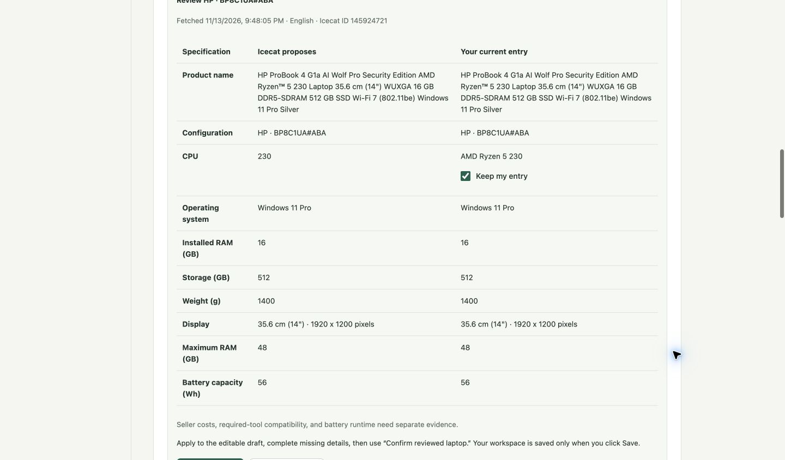

# Milestone 4 — reviewed Icecat imports

Status: local import milestone implemented and verified on November 13, 2026. Automated checks, three real MongoDB integration tests, and a live signed-in import/review/save/refresh/history journey passed. No deployment or paid subscription is included; version 1 remains in progress.

## User journey

In Current laptop or Candidates, expand **Import specifications from Icecat**. Enter a supported HTTPS Icecat catalogue link, Icecat ID, or brand plus exact MPN (including regional suffix). Fetch one product, inspect the proposed and current values, then apply the preview to the editable draft. Complete missing fields and confirm the laptop separately. Only confirmed revisions enter comparison. **Save workspace / Save changes remains explicit**; importing does not save a workspace or capture history.

Manual entry and other product reference links remain available. This version never scrapes retailer pages, searches a catalogue automatically, guesses a CPU performance score, imports seller prices, or equates battery Wh with runtime.

Installed RAM, maximum RAM, storage, processor model, OS, weight, display, and battery capacity are selected when safely available. Missing values stay blank/unknown. A different product clears the previous configuration's specs, seller costs, compatibility and battery-runtime evidence, retaining notes. Refreshing the same Icecat ID preserves manually changed or manually cleared values by default; the review lets the user choose source values instead. Existing confirmations and saved historical reviews remain unchanged until a new candidate revision is confirmed and explicitly saved.

## Local configuration

Set either `PDW_ICECAT_USERNAME` (the channel-partner username, not email) or `PDW_ICECAT_API_TOKEN` in ignored `backend/.env`, then restart the backend. API tokens take precedence and are sent only in the provider request header. Never commit account credentials. This implementation requests covered Open Icecat content; unavailable or subscription-restricted products fall back to manual input. No demo account is silently used.

The adapter follows the [official Product JSON manual](https://iceclog.com/manual-for-icecat-json-product-requests/) (v3.0, updated October 13, 2026, checked November 13). Request sections are `generalinfo,featuregroups`, language EN. Category 151 must identify a laptop; returned ID or exact case-insensitive brand/MPN must match the request. General feature IDs supply measurements; translated feature names are not matched heuristically. Raw units come from `Feature.Measure.Signs._` (the two older `Sign` properties are empty) and are normalized only through an explicit conversion table. Decimal marketed TB → 1000 GB; kg → 1000 g. Unsupported units, duplicate feature values, zero or fractional whole-number measurements remain unknown with review notes. Source update date is explicitly unavailable, distinct from server retrieval time. Full catalogue links retain their validated path with query/fragment removed. ID/MPN lookups retain an encoded part-number catalogue search link with an explicit instruction to match brand and Icecat ID; this avoids fabricating a product-page slug. Icecat’s older `/en/p.cgi` format was checked and returns 404.

## Boundaries and evidence

`POST /api/v1/imports/preview` uses the existing verified-account ownership and CSRF/origin checks (or explicit isolated local development mode). A request UUID identifies retries. MongoDB stores a private, immutable selected-field receipt, not the raw provider payload; it expires after 30 days. This temporary cache is the only provider data retained before the user saves a workspace, and contains no budget, notes, seller prices, account email, provider token, or arbitrary input URL. Successful retries return the same evidence; reusing a request ID for a different identifier conflicts. Concurrent identical requests may fetch twice but converge on the first stored receipt. Ten uncached attempts per account per minute bound provider traffic; rate buckets expire after two minutes.

Workspace saves validate evidence against the owner's receipt or the same owner's already-saved evidence. Client corrections change candidate values, never provider originals. Saving embeds the selected evidence so history, future exports, and copying one's workspace remain independent of temporary receipt expiry. An unsaved receipt older than 30 days must be fetched again. Account deletion/purge work must include `import_receipts` and `import_limits` along with the other owner collections.

The fixed outbound destination is `https://live.icecat.biz/api`. User links are parsed only as identifiers; arbitrary hosts, credentials, ports and redirects are never fetched. Requests use TLS verification, timeouts, an elapsed-read guard and a 2 MB decompressed response bound. Provider errors are mapped to safe user-facing categories without reflecting response bodies or secrets. No images, credential-bearing file links, marketing text or full response bodies enter the workspace. Evidence records attribution, product identity, selected raw values and units, normalized values, retrieval time, language, issues, and mapper version.

The current whole-workspace save/revision API remains the write boundary; this slice does not implement the earlier draft's per-decision import-draft persistence/confirmation endpoints. Review/apply/confirm is deliberately local until explicit save. Optimistic workspace revisions and immutable server-calculated history remain unchanged.

## Validation

- Frontend production build and all 17 frontend tests passed, including refresh corrections, replacement clearing, and baseline preservation.
- Backend mapping/HTTP/API tests cover exact identity, partial data, installed vs maximum RAM, battery capacity vs runtime, unsupported units, duplicate specs, private receipts, forged originals, old-workspace compatibility, request retries, origin denial, response bounds, redirects, and provider errors.
- Opt-in Mongo integration suite: `PDW_TEST_MONGO_URI=mongodb://127.0.0.1:27017 .venv/bin/python -m unittest backend.tests.test_imports.MongoImportTests -v`. Uses only fresh `pdw_test_*` databases and removes those test databases afterward.
- Backend full suite: 122 tests discovered; 96 passed and 26 database-dependent tests skipped in the restricted session. After correcting the live unit mapping and source-link handling, all 10 focused non-database import tests passed again.
- The user ran the three real MongoDB import tests: all passed (`Ran 3 tests in 151.096s`, `OK`). The earlier 23 real storage/account tests were verified in previous milestones; they were not rerun for this slice.
- Live Chrome journey used the existing verified account and HP `BP8C1UA#ABA`, Icecat ID `145924721`. Link, exact brand/MPN, and ID lookup all resolved the expected configuration. Corrected unit mapping populated 16 GB RAM, 512 GB storage, 1400 g weight, Windows 11 Pro, display/resolution, maximum RAM 48 GB, and battery capacity 56 Wh. Processor model was returned as `230`; the test user entry `AMD Ryzen 5 230` remained separately labeled as a correction during refresh.
- The sample workspace **Import check — sample laptop** explicitly saved through revision 3. A reload reopened revision 1 before later revisions were saved. The revision 1 historical review retained its original CPU model and retrieval evidence after revision 2 changed them. Comparisons classified missing costs/compatibility as needing verification and left the timeline unknown.
- Fixed an additional browser-discovered expired-cookie issue: known unauthenticated session errors now expose the sign-in link while keeping private content closed. A frontend regression covers that policy. General API tests now isolate their local configuration instead of accidentally using the developer’s Auth0/Mongo settings.
- Loading a different workspace remounts its import editors, preventing an old in-flight preview from applying to another workspace. Edits made while fetching invalidate the preview’s apply action.
- Coverage limit: the live verification uses one HP configuration; it does not establish coverage or correctness across all brands. Selected-field synthetic fixtures cover partial/malformed data, errors, unsupported units, and conversions. No real financial inputs were used.

## Remaining v1 work

JSON export; account deletion, 30-day recovery, notification email and purge jobs; individual workspace deletion; production hosting, backups and retention; final accessibility, security and operational verification. Automatic catalogue suggestions, other professions and device categories, and system inspection remain future scope.
