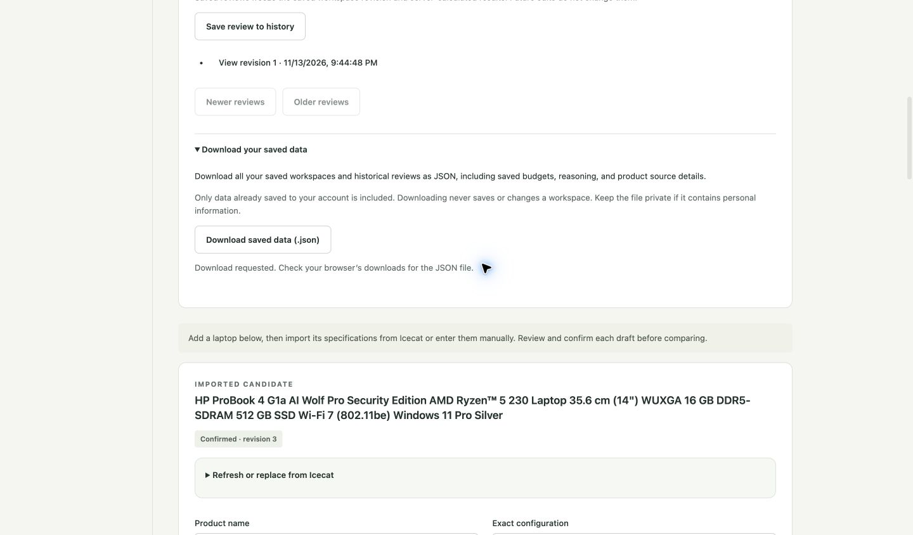

# Milestone 5 — saved-data JSON export

Status: local export milestone implemented and verified on November 13, 2026. Automated checks, a real MongoDB test, the signed-in browser download, and inspection of the downloaded JSON all passed. The import milestone was committed separately as `f4b0358`; this milestone is a new working change.

## Behavior

Expand **Download your saved data** in the saved-workspace panel and choose **Download saved data (.json)**. The file includes all saved workspaces and their historical reviews for the signed-in verified account: needs, preferences, candidate drafts and confirmed values, costs, budgets, contribution/calendar assumptions, reasoning, selected Open Icecat evidence, and frozen historical inputs/results/model versions. A warning explains that unsaved edits are excluded. Exporting does not save a workspace or create a review.

The attachment is `purchase-decision-workspace-export.json`, UTF-8 JSON with format `purchase-decision-workspace`, export version 1, USD currency, UTC read timestamps, record counts, `workspaces`, and `historical_reviews`. Workspace schema versions, revisions, date-only contribution values, IANA timezones, unknown values, and integer-cent calculations remain represented explicitly. Read-only export is not a JSON import/restore feature.

Only allowlisted record fields and validated workspace/evaluation contracts enter the file. Database owner IDs, Mongo `_id` values, Auth0 provider identities, application-session secrets, passwords, tokens, rate limits, and temporary import receipts are excluded. User-entered notes and saved financial inputs are intentionally included; the UI tells users to keep the file private. The server keeps no export file, persistent export job, or public download URL. Responses use attachment disposition, `application/json`, `Cache-Control: no-store`, `Pragma: no-cache`, and `nosniff`.

## Consistency and limits

`GET /api/v1/account/export` uses the existing server-derived owner, verified-email/account-state checks, and origin policy. It is read-only, so it does not require a mutation CSRF token. Local development mode exports only the separate demonstration owner.

All working documents are read with their revisions, and historical reviews created no later than the read-start timestamp are selected without recalculation. A second owner-filtered revision manifest detects workspace creation, deletion or updates observed during preparation. A review newer than the observed working revision also causes `409 export_changed`. The user can retry; no partial attachment is sent.

This is a documented **per-record read window**, not an account-wide transactional snapshot. A write after the final revision check may follow the exported revision; the file's revision IDs and read timestamps describe what was read. Historical reviews remain frozen records independent of later calculations or source refreshes. Exported older workspace states may gain explicit defaults for newly optional fields during schema validation; original saved documents are never changed.

The synchronous local implementation is bounded to 1,000 workspaces, 5,000 reviews, and 20,000,000 encoded bytes (including metadata), with database cursor time limits and a 30-second client timeout. Reaching a limit returns an explicit `413 export_too_large`, not silent truncation. A future larger-account export can add background jobs or chunked archives. Limits are server constants separate from financial arithmetic.

The download creates its object URL only after success. Sign-out, account/session changes, component unmount, or cancellation prevent a late file from being downloaded into another account's view. Errors never become JSON download files. Object URLs are revoked after use. Only the browser's normal download location holds the resulting file.

## Verification

- Eight focused non-database export tests passed: scope, ownership, no-cache attachment headers, blocked unauthenticated/unverified/cross-origin/restricted requests, empty exports, source evidence and corrections, frozen historical results, unfinished drafts, allowlisted fields, concurrent revision changes, and record/byte limits.
- Five download/session-context regressions passed, bringing the frontend suite to 22 passing tests. Production TypeScript/Vite build passed.
- The user ran `PDW_TEST_MONGO_URI=mongodb://127.0.0.1:27017 .venv/bin/python -m unittest backend.tests.test_exports.MongoExportTests -v`: one test passed in 0.234s. It exported 12 workspaces and 12 reviews, preserved ownership and revisions, and used only a fresh `pdw_test_*` database removed afterward.
- Full backend suite: 131 tests discovered, 104 passed and 27 opt-in database tests skipped in the restricted session. The new real MongoDB export test was run separately by the user and passed.
- Browser: the signed-in sample workspace showed the export control and successful request status. The automation download event timed out and access to `chrome://downloads` was blocked; no browser-policy workaround was used. The user confirmed the download and explicitly supplied the local file for inspection.
- The downloaded file was valid UTF-8 JSON, 27,743 bytes, containing two workspaces and two reviews. Every workspace, historical input, and historical result passed the server contracts. Counts matched the arrays. The sample workspace retained revision 3, the manually expanded CPU description, Icecat's original processor model, and the verified product-page link. Its revision 1 historical review still contained the original processor model. Authentication/server-only keys were absent. The private export was read in place, never copied into the repository or included in evidence.

## Remaining v1 work

Individual workspace deletion; account deletion and its 30-day recovery window; notification email and active-data purge jobs; hosting, backup retention and restore/deletion safeguards; final accessibility, security and operational verification. Automatic catalog suggestions, expanded professions/devices and system inspection remain future scope.
