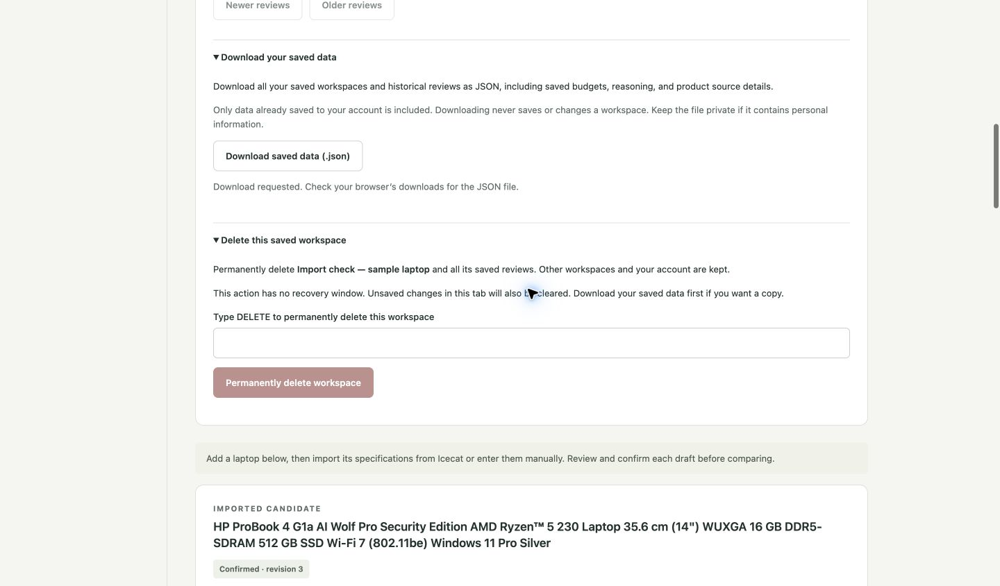

# Milestone 6 — workspace deletion and account recovery

Status: local implementation with database and UI verification. Export was committed separately as `01d2ce4`. Real SMTP delivery, real Auth0 identity deletion, automatic maintenance scheduling, and infrastructure backup expiration remain setup/deployment work. See [deletion and email setup](deletion-and-email-setup.md).

## Implemented behavior

- Individual workspace deletion requires the exact `DELETE` confirmation and the saved revision. Stale revisions conflict; another account sees 404. Working inputs are removed, reviews are deleted, and reads/lists/exports exclude the deleted workspace. A minimal tombstone makes retry IDs unable to recreate it. Repeating deletion is idempotent. There is no individual-workspace recovery window. The UI warns that unsaved tab edits will also be cleared when it opens a new workspace after success.
- Account deletion requires verified email, matching CSRF/origin, exact `DELETE MY ACCOUNT` confirmation, and authentication within the preceding five minutes. The request atomically sets a pending state, generation, request ID, notification status and deadline 30 × 24 hours later. Repeating a pending request does not extend the deadline. The user is signed out and existing sessions are revoked.
- Fresh sign-in during recovery creates a limited session. The normal workspace/import/export APIs remain closed. The recovery screen shows the exact local deadline and requires an explicit **Restore account** action. Restoration requires recent authentication, atomically changes the pending account to active only before the deadline, changes its generation, revokes old sessions, and issues a new normal session to reopen the preserved data. Signing in alone does not cancel deletion.
- At or after the deadline restoration fails, even before a worker has run. A purge claim and restoration race on the same user document, with only one winner. Account-state checks and pinned session generations prevent old sessions from reopening data after lifecycle changes. Profile updates cannot repopulate a purged account's email.
- A separate worker queues/retries notification delivery, removes due account-owned decisions, reviews, source receipts, import limits and sessions, then attempts dedicated Auth0 cleanup. Leases bound concurrent delivery/purge attempts; interrupted/failed jobs retry. Active purge timestamps and backup deadlines are recorded once. After provider cleanup, the user record contains only a suppression marker, never email or provider subject. Provider failure leaves only the restricted cleanup state and necessary subject after local private records are removed.
- Workspace deletion uses a durable parent tombstone rather than a multi-document transaction. Snapshot writes check the parent before and after insertion; reads are parent-gated. Maintenance repeats child cleanup to remove an orphan if a process dies during an in-flight snapshot write. Export may return a retry conflict while cleanup is incomplete. Temporary provider-only receipts remain subject to their existing 30-day cache expiration unless the entire account is purged.

## API and boundaries

- `DELETE /api/v1/decisions/{id}`: `{expected_revision, confirmation: "DELETE"}`, returns 204. Owner-derived authentication and mutation CSRF apply. HTTP 204 is now correctly accepted by the frontend API client.
- `GET /api/v1/account/lifecycle`: limited authenticated status, no private workspace inputs.
- `POST /api/v1/account/deletion-request`: `{request_id, confirmation: "DELETE MY ACCOUNT"}`, clears the app-session cookie and returns the deadline/queued notice state.
- `POST /api/v1/account/restore`: explicit fresh-authenticated recovery before the deadline; replaces the limited cookie with a new normal session.
- Existing `/auth/session`, `/auth/activity`, and `/auth/logout` support recovery-only sessions. Ordinary ownership dependencies still reject pending accounts. Local single-user demonstration mode has no account-deletion endpoint.
- No credentials were added to the real environment. The environment example contains only empty SMTP and dedicated deletion-client placeholders. No account, permission grant, notification email or scheduler was created by the coding session.

## Verification

- The user ran 33 real MongoDB regressions: 32 initially passed; the recovery journey stopped in a test helper that incorrectly used ordinary access to inspect a pending session. Correcting that helper to use limited-session access allowed all six lifecycle database tests to pass on rerun (1.120s). Existing storage, Auth0/session, import and export database checks passed in the original run. Only fresh `pdw_test_*` databases and fake email/Auth0 callbacks were used.
- Lifecycle database cases cover explicit restoration and preserved data, blocked ordinary APIs, exact recovery boundary, owner-isolated purge, suppression markers, provider retry and fixed backup deadline, notification retry, concurrent restoration/purge, revision-checked private workspace deletion, idempotency, and cleanup of simulated late children.
- Final offline suite: 146 tests discovered, 113 passed, 33 opt-in database checks skipped in this session. All 33 database cases were verified across the user runs. The final single recovery regression passed again in 0.334s after aligning restoration with the approved immediate-session behavior.
- Frontend production build and all 26 tests passed, including three renders of the actual lifecycle component and the pending-account access policy.
- Offline tests cover fresh authentication, typed confirmation, CSRF, cookie clearing, restricted access, SMTP TLS/message wording, missing SMTP, encoded provider subjects, dedicated deletion scope, unexpected provider statuses, and credential-safe worker failures.
- Frontend checks cover pending accounts losing private access and server-render the actual recovery/deletion component with synthetic props: explicit restore action, closed-window behavior, typed confirmation disabled initially, and honest unconfigured-email status. They add no fake runtime identity endpoints.
- Live Chrome displayed both confirmation forms. Incorrect/empty confirmation kept their final buttons disabled. Fields were cleared after checking. No deletion was submitted; the real account and its saved workspaces remain intact. The recovery UI is covered by synthetic component rendering and real database/API tests, not a deletion/recovery of the user's real Auth0 account.

## Remaining release work

Configure and verify SMTP and the dedicated Auth0 deletion client; supervise maintenance; choose hosting/backups and validate backup expiration/restoration with the suppression ledger; finalize minimal marker retention; complete accessibility/security/operational release checks. Version 1 is still a local implementation, not a deployed service with verified retention guarantees.
