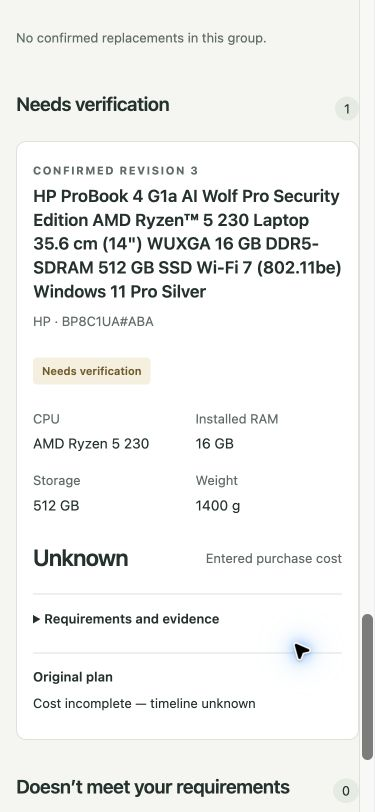

# Milestone 7 — local readiness and interface checks

Status: this local readiness, keyboard/mobile and dependency-check pass completed on November 13, 2026. The user selected **Finish local release checks first**. No hosting service, paid account, deployment, email provider, Auth0 grant or scheduler was created. The deletion/recovery checkpoint was committed separately as `6e36836`.

## Changes

- A read-only `python -m backend.app.readiness` reports configuration presence/shape without echoing secrets. It distinguishes missing/invalid settings from configuration that this command has not verified. Current local configuration has storage/Auth0/Icecat settings; SMTP and the dedicated cleanup client are missing.
- Optional `--check-database` reads connectivity, maintenance progress and counts of due recovery/purge work, delayed notices and backup deadlines requiring verification. It never executes that work or writes indexes/documents. Provider access, delivery, backups and a public deployment are never inferred from configuration alone.
- Maintenance records one bounded progress/finish status in `system_status`, separate from user data. Per-notice/per-account callbacks refresh progress so a working batch is not judged from its start timestamp alone. Failures are recorded without raw exception text. No scheduled job was installed or run against real user data.
- Shared text fields have explicit labels and separate `aria-describedby` hints. Candidate cards have accessible heading associations. The skip-link target is focusable; source tables have labeled focusable scroll regions; focus outlines are stronger. Name/source/title/timezone input limits now match their backend contracts. Long unbroken headings wrap within the viewport.
- [Verification](verification.md) now maps actual code/tests and dated milestone evidence to requirements instead of claiming there is no implementation. Production/service limits remain explicit.

## Observed browser checks

The existing verified account and saved **Import check — sample laptop**, revision 3, were used for reversible UI checks. No save or deletion was submitted.

- All five steps fit a 320 px CSS viewport without page-wide horizontal overflow. A 180-character unbroken product name also fit.
- Keyboard Enter on each step moved focus to its H1. The skip link moved focus to the main workspace.
- At 375 px, the source table stayed in a 309 px scroll region with 512 px content width. ArrowRight while the region was focused moved its scroll offset to 40 px without widening the page.
- A temporary fractional RAM value produced the existing validation alert, then was restored. Visible candidate fields had associated labels. Helper text was available separately as descriptions.
- Original product name and RAM were restored. Save remained disabled, confirming no unsaved workspace changes. The temporary viewport was reset to the original 1440 px width before finishing.
- Selected CSS color pairs were calculated: body text 13.65:1, muted text on the page 5.17:1, primary button text 7.25:1, error text 6.45:1, eligibility badges 5.68–6.22:1, focus outline on white 5.16:1. These sampled pairs do not cover every component state or constitute a full contrast audit.
- This is a targeted local check, not a formal accessibility audit, screen-reader certification, or independent usability study.

## Automated and operator evidence

- Six new non-database readiness/heartbeat tests pass: redacted settings, missing/malformed configuration, separate privileged-client identity, recent/stale/stalled/failing heartbeat states, overdue work, safe connectivity errors, and actual worker success/failure recording.
- The user ran the real MongoDB readiness test: one test passed in 0.462s. It ran maintenance only in a disposable `pdw_test_*` database with fake email/provider adapters, then proved diagnostics did not process an inserted overdue account.
- `pip check` completed with **No broken requirements found**. A sandbox cache-permission warning disabled the pip cache; it did not indicate a dependency conflict.
- Final local checks: 153 backend tests discovered, 119 passed and 34 opt-in database tests skipped in this session. The new real database readiness check passed separately; the preceding 33 database cases were verified during milestone 6. All 26 frontend tests and the strict TypeScript/Vite build passed.
- npm advisory access failed in the restricted session because the registry could not resolve, and the Python auditor was not installed there. The user then ran pip-audit 2.10.1 in a separate temporary virtual environment against the fully pinned backend requirements (`--no-deps --disable-pip`): **No known vulnerabilities found**. `npm audit` for the full frontend dependency tree reported **found 0 vulnerabilities**. No app dependencies or lockfiles were changed. The tool’s hash-lock recommendation is a reproducibility note; the lock is pinned but not fully hash-verified. These results concern known advisories at the time of the scan, not a security certification.

## Remaining release work

Complete screen-reader/zoom/full-contrast and broader keyboard-state checks; obtain independent usability feedback; configure and exercise real notification/provider cleanup; supervise maintenance; select and test hosting/backups/isolated restoration and suppression retention. The application remains local. The readiness report deliberately does not claim public-release readiness.
